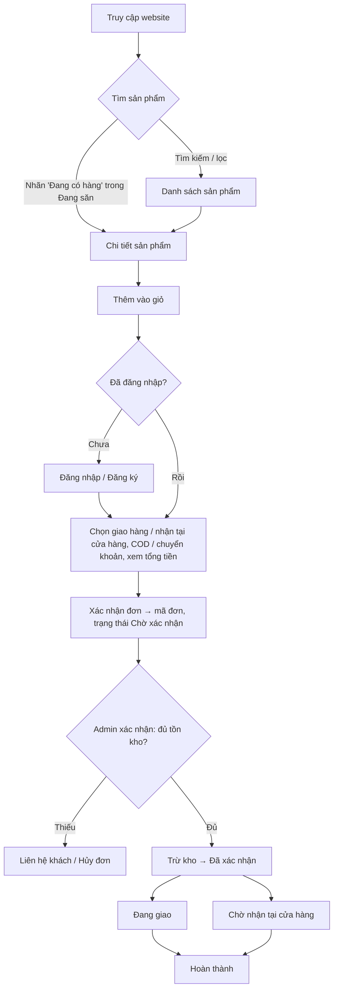
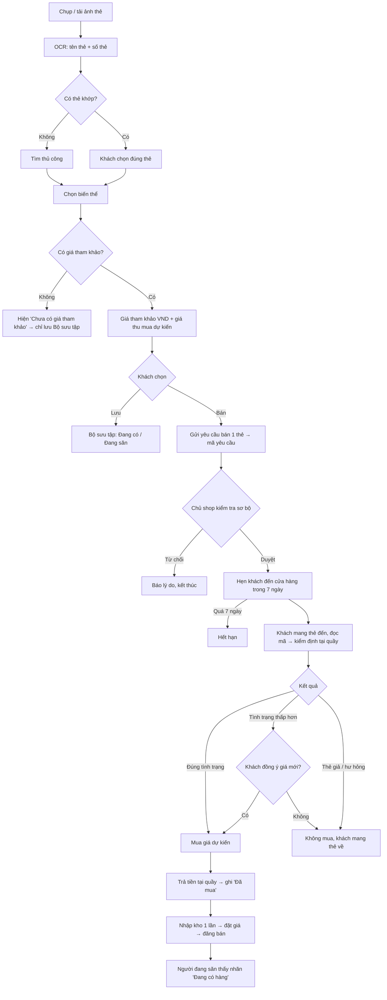
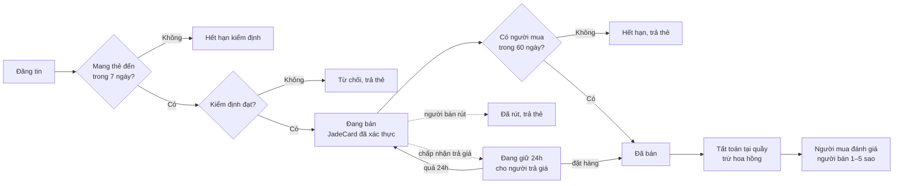

# Quy trình nghiệp vụ

> Cập nhật theo REQUIREMENTS **v2.0** (09/11/2026): thêm quy trình 4 (Ký gửi) và 5 (Cộng đồng). Mục 1–3 giữ từ v1.0 (07/11/2026), sau phản biện của AI thứ hai. Các mã PBxx trỏ tới [docs/ai-analysis/02-phan-bien.md](ai-analysis/02-phan-bien.md).

JadeCard có **hai quy trình chính** nối với nhau thành một vòng khép kín:

```
 (2) Thu mua: khách gửi yêu cầu online → mang thẻ đến cửa hàng → kiểm định, trả tiền → nhập kho thẻ lẻ
                                         │
                                         ▼
 (1) Bán hàng: khách khác tìm thấy thẻ lẻ → mua → giao hàng / nhận tại cửa hàng
```

Ngoài ra có quy trình phụ (3) **Bộ sưu tập**, giúp hai quy trình trên gặp nhau: tab *Đang có* đẩy khách sang bán thẻ, tab *Đang săn* đẩy khách sang mua thẻ.

---

## 1. Quy trình mua hàng

1. Khách truy cập website.
2. Tìm kiếm, chọn danh mục (*Hàng nguyên hộp* / *Thẻ lẻ*), hoặc bấm vào nhãn "JadeCard đang có hàng" trong tab *Đang săn*.
3. Xem chi tiết sản phẩm. Với thẻ lẻ: so sánh giá shop với giá tham khảo quốc tế, xem tình trạng và biến thể.
4. Thêm vào giỏ hàng (không vượt số tồn đang hiển thị).
5. Đăng nhập hoặc đăng ký nếu chưa có tài khoản.
6. Chọn **cách nhận hàng**: giao hàng (phí cố định 30.000đ) hoặc nhận tại cửa hàng (miễn phí, giữ đơn 7 ngày). Chọn **COD** hoặc **chuyển khoản**. Xem tổng tiền đã gồm phí.
7. Xác nhận đơn. Hệ thống lưu đơn, tạo mã đơn, hiển thị hướng dẫn chuyển khoản (nội dung = mã đơn). Có ghi chú: *"Đơn chưa giữ hàng cho đến khi shop xác nhận."*
8. Admin xác nhận đơn. Hệ thống **kiểm tra tồn kho**: đủ thì trừ kho ngay, thiếu thì không xác nhận được, admin liên hệ khách hoặc hủy đơn (PB12).
9. Giao hàng, hoặc chuẩn bị hàng chờ khách đến lấy.
10. Khách xem trạng thái đơn (tải lại trang để cập nhật).

**Trạng thái đơn hàng (PB13):**
- Giao hàng: `Chờ xác nhận → Đã xác nhận → Đang giao → Hoàn thành`
- Nhận tại cửa hàng: `Chờ xác nhận → Đã xác nhận → Chờ nhận tại cửa hàng → Hoàn thành`
- `Đã hủy`: khách tự hủy khi đơn còn "Chờ xác nhận", hoặc admin hủy. Hủy một đơn đã trừ kho thì **hoàn kho đúng một lần**. Đơn nhận tại cửa hàng quá 7 ngày chưa lấy thì admin hủy.

**Trạng thái thanh toán (theo dõi riêng):** `Chưa thanh toán → Đã thanh toán`. Đơn COD chuyển sang "Đã thanh toán" khi giao thành công. Đơn chuyển khoản chuyển khi admin đối chiếu đã nhận tiền. Hủy một đơn đã thanh toán thì admin hoàn tiền thủ công và ghi chú vào đơn.



---

## 2. Quy trình Check thẻ và Thu mua (quy trình đặc thù)

Nguyên tắc: **giữ đơn giản.** Trên web chỉ có phần gửi yêu cầu. Việc kiểm định, chốt giá và trả tiền diễn ra **trực tiếp tại cửa hàng**. Không gửi thẻ qua bưu điện, không thanh toán thu mua online, không lưu thông tin tài khoản ngân hàng của khách.

**Phần online: khách hàng**
1. Mở **Check thẻ**, chụp hoặc tải ảnh mặt trước thẻ Pokémon (bản tiếng Anh).
2. Hệ thống chạy OCR, đọc **tên thẻ** (góc trên) và **số thẻ** (góc dưới, vd. `025/165`).
3. Hệ thống tìm trong nguồn dữ liệu thẻ (TCGdex), hiển thị tối đa 5 thẻ khớp. **Khách chọn đúng thẻ, sau đó chọn biến thể** (normal / holo / reverse holo) (PB07). Nếu không thẻ nào đúng, khách bấm "Không có thẻ phù hợp" để tìm thủ công.
4. Hệ thống hiển thị **giá tham khảo quốc tế (quy đổi VND)** và **giá thu mua dự kiến** theo từng tình trạng NM/LP/MP/HP. Nếu biến thể đó chưa có giá, hệ thống hiện "Chưa có giá tham khảo" và khách không bán được thẻ này qua web (PB09).
5. Khách chọn một trong ba hướng:
   - **Lưu vào Bộ sưu tập** (*Đang có* hoặc *Đang săn*);
   - **Bán cho JadeCard**: đi tiếp bước 6 (chỉ khi thẻ có giá và đạt ngưỡng);
   - Không làm gì thêm.
6. Khách tạo **yêu cầu bán cho đúng 1 thẻ** (PB15): tự đánh giá tình trạng, chụp ảnh mặt trước và mặt sau, nhập SĐT liên hệ, đồng ý điều khoản *"giá chốt sau kiểm định tại cửa hàng"*. Hệ thống lưu lại giá, tỉ giá, hệ số và thời điểm (PB16), rồi cấp **mã yêu cầu**.

**Phần online: chủ shop kiểm tra trước giao dịch**

7. Chủ shop xem ảnh và thông tin để **kiểm tra sơ bộ** (thẻ có vẻ thật không, ảnh có rõ không, shop có đang cần thẻ này không):
   - **Duyệt:** khách được hẹn mang thẻ đến cửa hàng **trong 7 ngày**.
   - **Từ chối:** ghi lý do có sẵn (dưới ngưỡng giá, shop đã đủ hàng, nghi thẻ giả, ảnh không rõ). Khách không phải mất công đến cửa hàng.

**Phần tại cửa hàng**

8. Khách mang thẻ đến và đọc **mã yêu cầu**. Chủ shop tìm yêu cầu trên trang quản trị.
9. **Kiểm định trực tiếp trước mặt khách** (thật/giả, tình trạng thực tế), có thể quay video làm bằng chứng (video lưu ngoài hệ thống).
10. **Chốt giá tại quầy:**
    - Tình trạng đúng như khách khai: mua đúng giá dự kiến đã lưu.
    - Tình trạng thấp hơn: báo giá mới theo hệ số của tình trạng thực tế. Khách đồng ý thì bán, không đồng ý thì mang thẻ về.
    - Thẻ giả hoặc hư hỏng: từ chối, khách mang thẻ về.
11. Nếu mua: **trả tiền tại quầy** (tiền mặt hoặc chuyển khoản tại chỗ). Admin ghi kết quả **Đã mua** (tình trạng thực tế, giá chốt, hình thức trả tiền). Nếu không mua: ghi **Không mua** kèm lý do.
12. **Nhập kho** (một lần cho mỗi yêu cầu, PB17): nếu đã có sản phẩm thẻ lẻ trùng *`cardId` + biến thể + ngôn ngữ + tình trạng* thì tăng tồn thêm 1, nếu chưa có thì tạo sản phẩm mới ở trạng thái ẩn.
13. Admin đặt giá bán và cho hiển thị sản phẩm. Những khách đang săn thẻ này sẽ thấy nhãn **"JadeCard đang có hàng"** ở lần mở trang tiếp theo. Từ đây thẻ đi vào **quy trình 1**.

**Trạng thái yêu cầu bán:**
- Luồng chính: `Chờ duyệt → Đã duyệt (chờ khách mang thẻ đến) → Đã mua → Đã nhập kho`
- Kết thúc khác:
  - `Từ chối`: shop từ chối khi kiểm tra online.
  - `Không mua`: tại quầy (thẻ giả, khách không đồng ý giá mới, hư hỏng).
  - `Khách hủy`: khi yêu cầu còn "Chờ duyệt" hoặc "Đã duyệt".
  - `Hết hạn`: quá 7 ngày khách không đến. Khách gửi yêu cầu mới nếu vẫn muốn bán.



---

## 3. Quy trình Bộ sưu tập (phụ)

1. Thẻ được thêm vào từ kết quả Check thẻ hoặc tìm thủ công, kèm biến thể, giá tham khảo và ngày lưu.
2. **Đang có:** khách cập nhật số lượng và tình trạng. Hệ thống tính **"Tổng giá tham khảo tại thời điểm lưu"** (thẻ chưa có giá được đếm riêng, không tính là 0đ) (PB19).
3. Khách bấm **"Bán thẻ này"** ở một thẻ trong *Đang có*. Thao tác này mở form yêu cầu bán của quy trình 2 (bước 6) với thông tin thẻ được điền sẵn. Đây chỉ là **một lối vào khác** của cùng biểu mẫu (PB05).
4. **Đang săn:** khi kho có sản phẩm thẻ lẻ cùng `cardId` và biến thể, **đang hiển thị** và **còn hàng**, trang hiện nhãn "JadeCard đang có hàng" kèm link sang quy trình 1, bước 3 (PB20).

**Lưu trữ:** ở v1.0, bộ sưu tập gắn với **trình duyệt** (PB22). Từ **v2.0**:
- Đăng nhập thì bộ sưu tập lưu theo **tài khoản**. Lần đầu đăng nhập, hệ thống hỏi có gộp bộ sưu tập trên trình duyệt vào không.
- Người khác xem được bộ sưu tập khi bấm avatar (F27). Mặc định ẩn tổng giá trị; chủ có thể để riêng tư.
- % hoàn thành set vẫn thuộc mục Nâng cao (PB21).

> **Buổi 1** chỉ mô tả quy trình. Việc triển khai làm dần từ Buổi 2 (giao diện) và Buổi 3 (JavaScript, localStorage). Phần thu mua và quản trị cần backend nên làm ở Giai đoạn 4.

---

## 4. Quy trình Ký gửi tại cửa hàng (v2.0)

Thành viên bán thẻ **qua** JadeCard thay vì bán đứt cho shop (khác quy trình 2). Shop giữ thẻ, bán hộ, thu hoa hồng 8% (tối thiểu 20.000 ₫).

1. Thành viên (đã xác thực email) **đăng tin**: chọn thẻ và biến thể, tình trạng tự đánh giá, 2–6 ảnh, giá mong muốn. Hệ thống hiện trước hoa hồng và số tiền dự kiến nhận. Tin ở trạng thái **Chờ kiểm định**, chưa công khai.
2. Thành viên có thể mở topic **Mua bán** trong F368 và gắn tin này. Thẻ sản phẩm hiện nhãn "Chưa xác thực".
3. Trong **7 ngày**, thành viên mang thẻ đến cửa hàng, đọc mã tin (ví dụ KG-0042).
4. Admin **kiểm định tận tay**: thật hay giả, tình trạng thực tế, chụp ảnh tại shop, thống nhất giá niêm yết với người bán.
   - Đạt → **Đang bán**, có huy hiệu "JadeCard đã xác thực". Shop giữ thẻ.
   - Không đạt → **Từ chối** kèm lý do, trả thẻ ngay.
5. Người mua thêm tin vào giỏ và đặt hàng như sản phẩm của shop (quy trình 1). Có đơn thì tin bị giữ; đơn xác nhận thì tin chuyển **Đã bán**. Thẻ trong topic F368 hiện "ĐÃ BÁN".
6. Người bán đến quầy nhận tiền (tiền mặt hoặc chuyển khoản tại chỗ) = giá bán − hoa hồng. Admin ghi **Đã tất toán**. Hệ thống không lưu số tài khoản ngân hàng.
**Trả giá (F55, v2.1):** trong lúc tin "Đang bán", người mua có thể đề nghị giá (50% đến dưới 100% giá niêm yết, hết hạn sau 48 giờ).
- Người bán từ chối → không có gì thay đổi.
- Người bán chấp nhận → tin chuyển **Đang giữ cho người trả giá** trong 24 giờ, chỉ người đó đặt hàng được với giá đã chốt.
- Quá 24 giờ chưa đặt hàng → tin trở lại "Đang bán".
- Hoa hồng tính trên giá bán cuối cùng.

**Đánh giá (F56, v2.1):** đơn hoàn thành thì người mua chấm 1–5 sao cho người bán (một lần mỗi dòng đơn).

7. Quá 60 ngày chưa bán → **Hết hạn niêm yết**, người bán đến lấy lại thẻ. Người bán có thể **rút tin** bất cứ lúc nào trước khi có đơn.



## 5. Quy trình Cộng đồng (v2.0)

```
Mua pack / thẻ lẻ ──► khoe bóc thẻ, hỏi giá ở F368 ──► nhận like ──► lên chức vụ
        ▲                        │
        │                        ▼
 Mua tiếp, đổi lên lá xịn ◄── Ký gửi (topic Mua bán) ◄── Check giá, thêm vào Bộ sưu tập
```

1. **Tài khoản:** đăng ký → nhận OTP 6 số qua email → kích hoạt. Chưa xác thực thì chỉ đọc được, không viết bài, like hay ký gửi.
2. **Diễn đàn:** thành viên tạo topic (có tag tiền tố) trong F368 hoặc F666, trả lời, trích dẫn, like.
   - Tổng like nhận được quyết định **chức vụ**: Chiếu mới → Học việc → Thợ săn sơ cấp → Thợ săn chuyên nghiệp → Thợ săn lão làng → Master → Grand Master.
   - Tag chức vụ hiện cạnh tên ở mọi nơi.
3. **Hồ sơ và bộ sưu tập:** bấm avatar hoặc tên bất kỳ ai sẽ mở hồ sơ, tab đầu là **Bộ sưu tập**. Thẻ đang ký gửi có nhãn "Đang bán" dẫn sang tin ký gửi. Đây là cầu nối từ khoe thẻ sang mua bán.
4. **Kiểm duyệt:** thành viên báo cáo bài vi phạm. Mod/Admin ẩn bài, khóa topic. Bài rao bán ngoài ký gửi bị ẩn theo Quy định diễn đàn.
